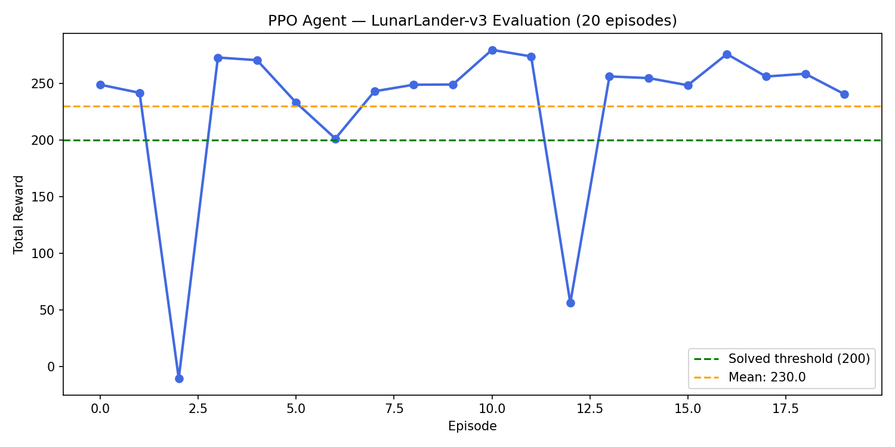

# Lunar Lander PPO — Reinforcement Learning Agent

A reinforcement learning agent trained to autonomously land a rocket using **Proximal Policy Optimization (PPO)**, implemented with [Stable-Baselines3](https://stable-baselines3.readthedocs.io/) and [Gymnasium](https://gymnasium.farama.org/).

This project applies the same family of policy gradient methods used in real-world robotic control systems to solve OpenAI's `LunarLander-v3` environment.

---

## Results

- **Mean reward: 230** across 20 evaluation episodes
- Solved threshold: 200
- Trained for 500,000 timesteps on CPU



---

## How it works

The agent observes 8 state variables at each frame (position, velocity, angle, leg contact) and outputs one of 4 discrete actions (fire left/right/main engine or do nothing). PPO updates the policy by maximizing expected reward while keeping updates stable via a clipping mechanism — preventing destructive large policy updates.

---

## Stack

- Python 3.11
- [Stable-Baselines3](https://stable-baselines3.readthedocs.io/) — PPO implementation (built on PyTorch)
- [Gymnasium](https://gymnasium.farama.org/) — LunarLander-v3 environment
- PyTorch
- Matplotlib

---

## Usage

**Install dependencies:**
```bash
pip install gymnasium[box2d] stable-baselines3 torch matplotlib
```

**Train the agent:**
```bash
python train.py
```

**Evaluate and visualize:**
```bash
python evaluate.py   # watch the agent land in real time
python plot.py       # generate rewards plot
```

---

## Project structure

```
├── train.py          # PPO training script (500k timesteps)
├── evaluate.py       # Visual evaluation (renders landing)
├── plot.py           # Reward plot across 20 episodes
├── rewards_plot.png  # Evaluation results
└── lunar_lander_ppo.zip  # Saved model weights
```
